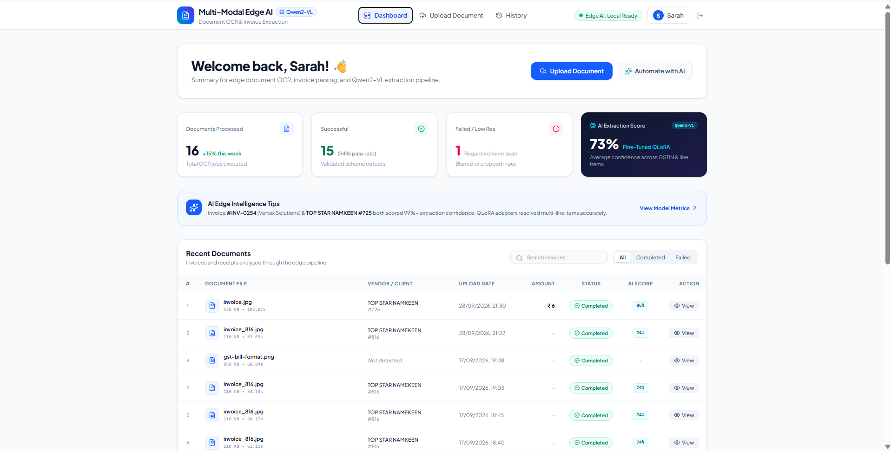
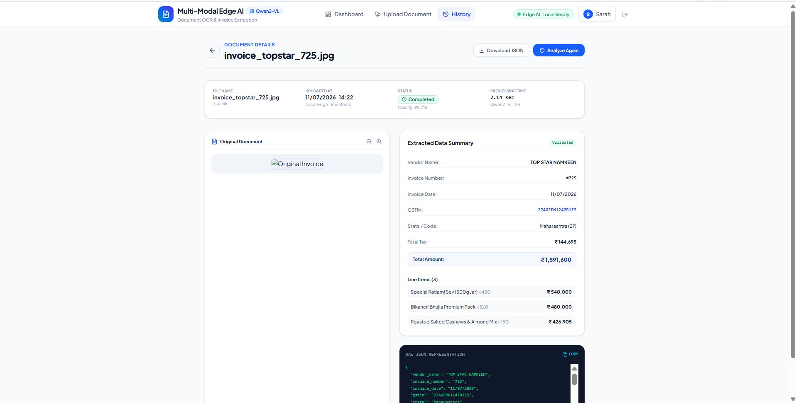

# 📄 Multi-Modal Edge AI

### Document OCR & Invoice Extraction with Qwen2-VL and QLoRA

Multi-Modal Edge AI is an AI-powered document processing project that explores extracting structured information from invoice and receipt images using a vision-language model. The system uses **Qwen2-VL-2B-Instruct**, fine-tuned with a **QLoRA adapter**, to identify document fields and convert visual information into structured JSON.

The project combines multimodal inference, parameter-efficient fine-tuning, a Python FastAPI backend, and a React-based frontend to demonstrate an end-to-end document extraction pipeline.

## 🖥️ Dashboard Preview



*The application dashboard showing document processing statistics, extraction status, and recent documents.*

## 🧾 Invoice Extraction Preview



*The extraction interface displaying invoice details, line items, totals, and a raw JSON representation of the model output.*

## 🎯 Project Objectives

- Explore document understanding using a vision-language model.
- Extract structured information from invoice and receipt images.
- Fine-tune a pretrained multimodal model using QLoRA.
- Use 4-bit quantization to reduce model memory requirements.
- Convert model-generated responses into structured JSON.
- Build a frontend and backend for interactive document analysis.
- Investigate the challenges of extracting accurate line items, quantities, prices, and invoice totals.

## ⚙️ System Architecture

The project follows an end-to-end document processing pipeline:

1. **Document Upload:** The user uploads an invoice or receipt image through the web interface.
2. **Image Processing:** The backend loads and prepares the image for multimodal inference.
3. **Vision-Language Model:** Qwen2-VL processes the document image and the extraction instructions.
4. **QLoRA Adapter:** The fine-tuned adapter is attached to the pretrained model to adapt it to the extraction task.
5. **Structured Extraction:** The model generates a JSON-style response containing the requested fields.
6. **API Response:** FastAPI returns the extracted information and processing metadata.
7. **Results Dashboard:** The React frontend presents the extracted fields and line items to the user.

## 🧠 Technologies Used

- **Python** — Backend implementation and model inference
- **PyTorch** — Deep learning and model execution
- **Hugging Face Transformers** — Vision-language model and processor
- **Qwen2-VL-2B-Instruct** — Pretrained multimodal model
- **PEFT / LoRA** — Parameter-efficient model adaptation
- **QLoRA** — Fine-tuning with quantized model weights
- **BitsAndBytes** — 4-bit quantization
- **FastAPI** — Backend API
- **Uvicorn** — ASGI server
- **React** — Frontend interface
- **TypeScript** — Frontend application logic
- **Vite** — Frontend development and build tooling
- **CORD Dataset** — Receipt understanding and structured extraction experiments

## 📁 Project Structure

```text
multimodal-edge-ai/
├── backend/
│   ├── api.py
│   ├── training_dataset.py
│   ├── preprocess_cord.py
│   ├── evaluate_model.py
│   ├── evaluate_metrics.py
│   └── archive/
│       └── experiments/
├── frontend/
│   ├── src/
│   ├── package.json
│   └── ...
├── data/
│   └── samples/
├── outputs/
│   └── qlora_mini/
├── screenshots/
│   ├── dashboard.png
│   └── extraction-results.png
├── .gitignore
├── check_gpu.py
└── README.md
```

*The structure above highlights the main project components. Additional frontend, backend, and experiment files may be present.*

## 🚀 Getting Started

### Prerequisites

- Windows 10/11 or a compatible development environment
- Python 3.12 recommended for the current setup
- Node.js and npm
- Git
- A compatible NVIDIA GPU is recommended for local quantized model inference
- Hugging Face access to download the pretrained model

### 1. Clone the repository

```bash
git clone https://github.com/Godson-1307/multimodal-edge-ai.git
cd multimodal-edge-ai
```

Replace the repository URL above if your GitHub repository uses a different name or URL.

### 2. Create and activate the Python environment

**Windows PowerShell:**

```powershell
python -m venv slm_env
.\slm_env\Scripts\Activate.ps1
python -m pip install --upgrade pip
```

Install the backend dependencies using the project's dependency file, if one is included in the repository. Otherwise, install the compatible dependencies documented by the project before starting the API.

### 3. Prepare the model adapter

The backend is configured to use:

- Base model: `Qwen/Qwen2-VL-2B-Instruct`
- Adapter directory: `outputs/qlora_mini`

The pretrained model can be downloaded through Hugging Face when the application starts.

**Important:** Model weights and generated checkpoints may be excluded from GitHub because of their size. The `outputs/qlora_mini/` adapter must be available locally before running inference. If it is not included in the repository, obtain the adapter separately or reproduce it using the project's training workflow.

### 4. Start the backend

From the project root:

```powershell
python -m uvicorn backend.api:app --reload --host 127.0.0.1 --port 8000
```

Check the API health endpoint:

```text
http://127.0.0.1:8000/health
```

Interactive API documentation is available at:

```text
http://127.0.0.1:8000/docs
```

### 5. Start the frontend

Open a second terminal:

```powershell
cd frontend
npm install
npm run dev
```

Open the local URL printed by Vite, which is configured to use port `3000` in the current development setup:

```text
http://localhost:3000/
```

You can then upload a document and inspect the extraction results.

## 🔬 Model Training and Evaluation

The project uses the CORD receipt dataset to explore multimodal document extraction and QLoRA-based adaptation.

The training workflow uses a pretrained vision-language model with a parameter-efficient LoRA configuration. Four-bit quantization helps reduce memory usage during model loading and training.

Experiments have investigated:

- Structured JSON generation
- Line-item name, quantity, and price extraction
- Total tax and total amount extraction
- Prompt design and output consistency
- Inference time and GPU memory usage

Evaluation results depend on the dataset split, sample selection, prompt, image resolution, and generation settings. Training-sample demonstrations should not be treated as independent evidence of generalization.

## ⚠️ Current Limitations

This project is an experimental prototype, and extraction accuracy is still being improved.

- Some invoice fields may be missing or returned as `null`.
- Similar-looking item names can be misread.
- Quantities and prices may be incorrect.
- Invoice totals and tax values can be difficult to extract reliably.
- The displayed interface metrics are not necessarily independently validated accuracy measurements.
- Results may vary across different invoice layouts and document types.

Extracted values should be verified against the original document before being used for accounting or other important business operations.

## 🔮 Future Improvements

- Improve extraction of invoice totals and tax fields.
- Evaluate prompts and image-processing strategies for different invoice layouts.
- Expand testing across more independent samples and document types.
- Improve JSON validation and error handling.
- Add confidence estimation supported by actual model evidence.
- Support export to CSV, Excel, or accounting systems.
- Add human review and correction workflows.
- Explore deployment options for practical document processing.

## 🎓 Project Scope

Multi-Modal Edge AI explores the use of vision-language models for document understanding, parameter-efficient fine-tuning, quantized inference, and web-based AI applications.

The project demonstrates an end-to-end prototype while investigating the challenges of reliable information extraction from real-world documents. It is intended for educational and experimental use rather than as a fully validated production accounting system.

## 👤 Developer

**Godson Nadar**

Artificial Intelligence and Machine Learning  
St. Francis Institute of Technology (SFIT)

## 📄 License

No license has currently been specified. Please contact the repository owner before reusing or redistributing the project.
